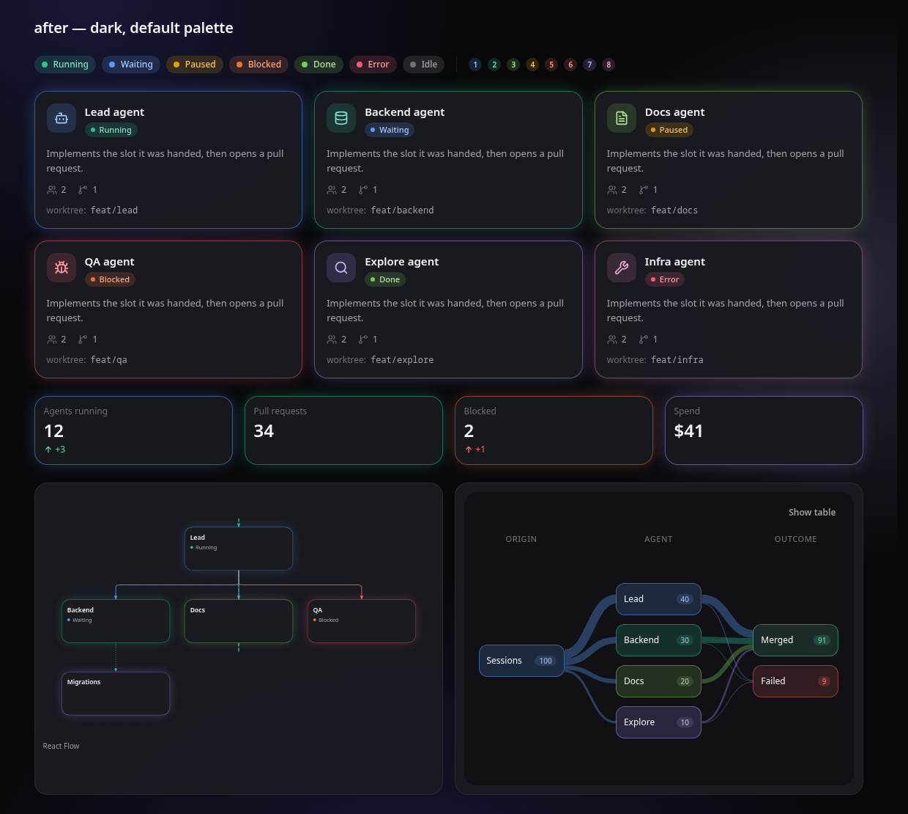
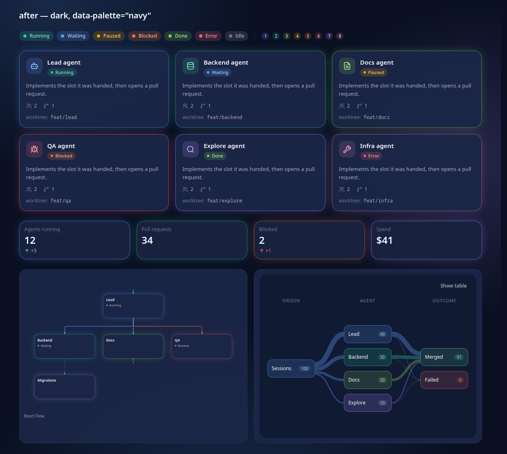
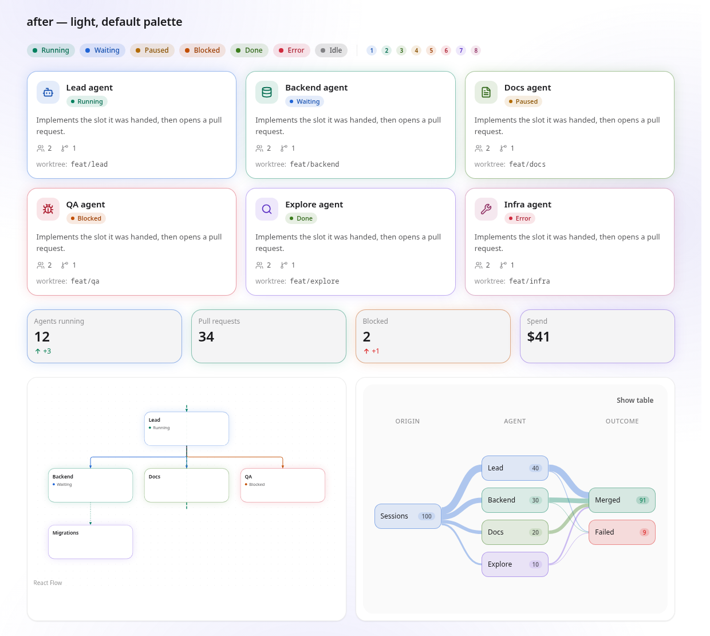
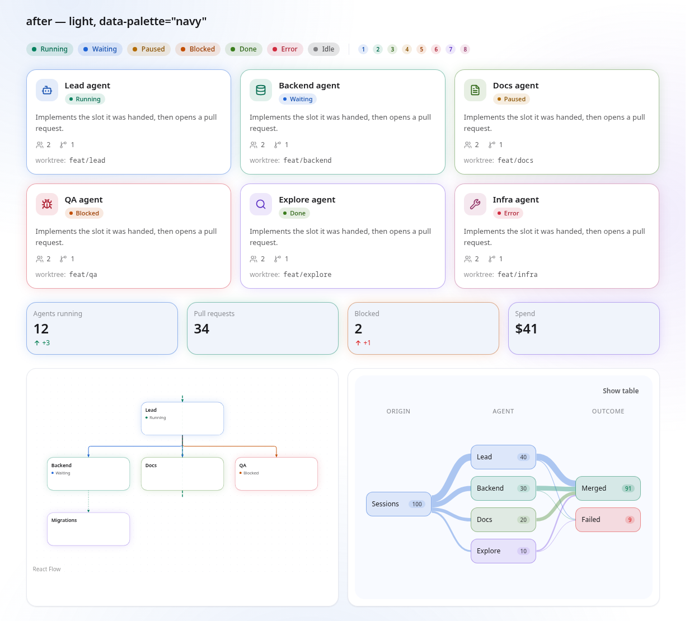
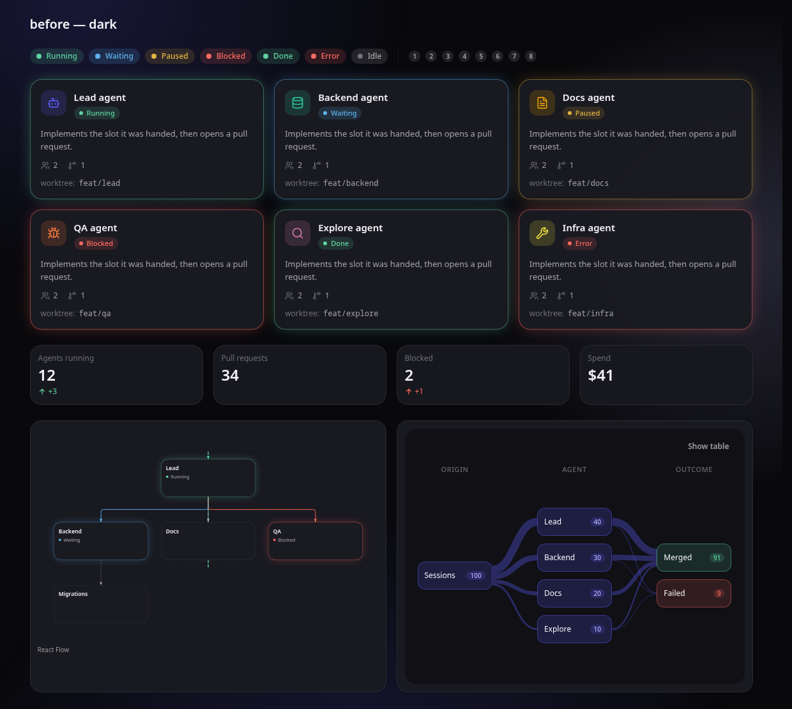
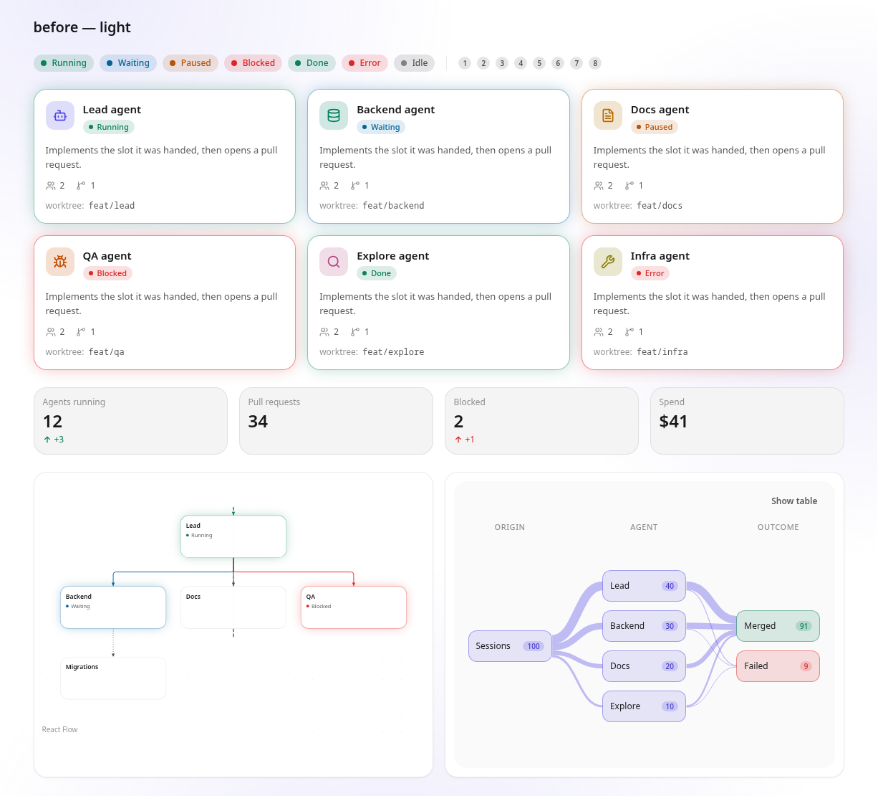

# glass-ui

**The Liquid Glass design system for React 19 and Tailwind CSS 4: tokens, a glass material, and the components built from them.**

[](https://www.npmjs.com/package/@andrewbehma/glass-ui)
[](LICENSE)
[](https://glass.luna-realm.com)

Two applications that want the same frosted-glass look usually end up with two
copies of it: drifting colours, hand-tuned blurs, and buttons that are almost the
same. glass-ui is the one copy. It was lifted out of Luna Watch so that more than
one product can be built from the same material, and it now also carries
[AgentDock](https://github.com/AndreyBegma/AgentDock)'s whole web UI.

**Who it is for:** React 19 applications on Tailwind CSS 4 (Next.js included)
that want a consistent glass look, from a television-style "sofa" interface to a
dense desktop dashboard, without writing their own primitives.

- **Live demo:** [glass.luna-realm.com](https://glass.luna-realm.com): every component rendered live, with a props playground, its states, copyable code and a JSX editor. Source: [glass-ui-showcase](https://github.com/AndreyBegma/glass-ui-showcase).
- **npm:** [`@andrewbehma/glass-ui`](https://www.npmjs.com/package/@andrewbehma/glass-ui) — `npm i @andrewbehma/glass-ui`
- **Used by:** [AgentDock](https://github.com/AndreyBegma/AgentDock), whose UI is built only from glass-ui components.

## What is in it

- **Tokens** — palette, radius, motion, density and type scales, a z-index
  ladder, eight identity hues and six status colours, and five independent
  switches (`data-theme`, `data-material`, `data-scale`, `data-accent`,
  `data-palette`) for light/dark, glass/flat, sofa/desk density, a named
  accent preset and a named surface palette.
- **The material** — `glass`, `glass-strong`, `glass-clear` and `lit` for
  chrome, `surface-content` for content, and the `.canvas` behind them, with
  the fallbacks they need.
- **Primitives** — Button, Card, Chip, Badge, Banner, Avatar, Field, Input,
  Select, Combobox, Checkbox, Radio group, Toggle, Slider and Range slider,
  Number, Date and Cron inputs, Dialog, Sheet, Menu, Context menu, Tooltip,
  Tabs, Segmented control, Table, Progress, Spinner, Skeleton, Sparkline,
  Toast, Code block, File dropzone and more.
- **Patterns** — app and nav rails, bottom capsule, breadcrumb, command
  palette, toolbar, popover, side panel, split pane, data table, tree, trace
  tree, timeline, board, stat tile, widget grid, log viewer, terminal, a file
  upload row and a dependency-free SVG chart.
- **Shipped as compiled ESM** with type declarations and one subpath per
  module; client components keep `'use client'`, so they render from React
  Server Components with no `transpilePackages`.

Three layers, imported separately so an application can take the first two and
decline the third:

| Import | What it is |
|---|---|
| `@andrewbehma/glass-ui/tokens.css` | The palette, the radius, motion, density and type scales, the z-index ladder, and the four axes below. Declares its own `@source`, so a consumer does not have to know that Tailwind cannot see into `node_modules`. |
| `@andrewbehma/glass-ui/material.css` | `glass`, `glass-strong`, `glass-clear` and `lit`, `surface-content`, the `.canvas` layer, and every fallback they need. |
| `@andrewbehma/glass-ui/base.css` | Opinions that apply to a whole document: the focus ring, the reduced-motion override, the depth effect under a sheet. Optional. |
| `@andrewbehma/glass-ui` | The primitives and `cn`. |

**Contents:** [Install](#install) · [Quick start](#quick-start) ·
[The look](#the-look) · [The rules](#the-rules) · [Motion](#motion) ·
[The shell patterns](#the-shell-patterns) ·
[The workspace patterns](#the-workspace-patterns) ·
[The data primitives](#the-data-primitives) ·
[The widget grid](#the-widget-grid) ·
[Desk dashboard primitives](#desk-dashboard-primitives) ·
[Desk activity primitives](#desk-activity-primitives) ·
[Desk automation primitives](#desk-automation-primitives) ·
[File input](#file-input) ·
[Developing](#developing) · [Releasing](#releasing) · [License](#license)

## Install

```sh
npm i @andrewbehma/glass-ui
# or: bun add @andrewbehma/glass-ui / pnpm add @andrewbehma/glass-ui
```

The package ships compiled ESM and type declarations in `dist/`, one file per
source module, with every subpath (`@andrewbehma/glass-ui/button`,
`@andrewbehma/glass-ui/dialog`, `@andrewbehma/glass-ui/tokens.css`, …) in its
`exports` map. The client components keep their `'use client'` directive, so
they can be rendered straight from a React Server Component. **No
`transpilePackages` is needed** in Next.

**Peer dependencies.** The application provides these:

```sh
npm i react react-dom tailwindcss lucide-react motion sonner \
  @radix-ui/react-dialog @radix-ui/react-dropdown-menu @radix-ui/react-popover \
  @radix-ui/react-tooltip @radix-ui/react-context-menu @radix-ui/react-slider
```

`cron-parser`, `cronstrue`, `@xterm/xterm` and `@xterm/addon-fit` are optional,
needed only by `@andrewbehma/glass-ui/cron-input` and
`@andrewbehma/glass-ui/terminal` — see [Desk automation
primitives](#desk-automation-primitives).

`lucide-react` is a peer dependency on a permissive range on purpose: its icon
names have moved between major versions, and an application should be able to
upgrade its icons without waiting for this package.

**Stylesheets and Tailwind 4.** Import the layers from the application's global
stylesheet, after Tailwind:

```css
@import "tailwindcss";
@import "@andrewbehma/glass-ui/tokens.css";
@import "@andrewbehma/glass-ui/material.css";
@import "@andrewbehma/glass-ui/base.css"; /* optional */
```

The components carry Tailwind class names, and Tailwind does not scan
`node_modules` on its own. `tokens.css` declares `@source "."` relative to
itself, so importing it is enough: Tailwind scans the package's `dist/`. An
application that does not import `tokens.css` adds the scan path itself,
relative to its own stylesheet:

```css
@source "../node_modules/@andrewbehma/glass-ui/dist";
```

Both were verified against a Next 16.4 + Tailwind 4.3 application installing the
packed tarball: with either, the classes used only inside the package's
components are generated; with neither, they are not.

**Git dependencies.** Up to `v0.22.0` the package was consumed as
`github:AndreyBegma/glass-ui#v0.22.0` and shipped its TypeScript source. A git
dependency on any later commit gets no `dist/` — it is built at publish time and
is not in the repository — so use the npm package.

## Quick start

With the stylesheets imported as above, import each component from its own
subpath (the barrel works too, but loads every module — see `src/index.ts`):

```tsx
import { Button } from '@andrewbehma/glass-ui/button';
import { Card } from '@andrewbehma/glass-ui/card';

export function Welcome() {
  return (
    <Card variant="glass" pad="lg">
      <h2 className="text-ink">Hello</h2>
      <p className="text-ink-2">Built from tokens, not hex codes.</p>
      <Button variant="solid">Continue</Button>
      <Button variant="ghost">Later</Button>
    </Card>
  );
}
```

`Button` has four variants (`solid`, `glass`, `ghost`, `danger`) and three sizes
(`sm`, `md`, `lg`); `Card` has `content` (the default), `raised`, `surface`,
`glass` and `plain`. Mount `<Canvas />` once behind the app so the glass has
something to refract; see [The look](#the-look). To
switch the look for the whole document, set the axes on `<html>`, for example
`<html data-theme="dark" data-scale="desk">` for a dense dark dashboard. Every
axis does nothing until it is set; [the rules](#the-rules) explain each one.

## The look

#93. A UI audit of AgentDock found glass-ui reading as a flat grey admin
template rather than as glass: the material sat on a plain page with nothing
behind it to refract, every card was the same grey, there was no colour of its
own, and modal scrims blurred the page into mud. The direction since 0.24.0,
in both themes, minimal and cheap to render:

**A canvas behind everything.** `<Canvas />` (`@andrewbehma/glass-ui/canvas`),
or any element with the `.canvas` class, paints three large, soft radial
gradients of the accent behind the app: `--canvas-glow` of the accent, 18 % in
dark and 10 % in light. It is `position: fixed` at `z-index: -1`, with no
`filter` and no animation, so it costs one composited layer and nothing on
scroll. Mount it once, **outside `#main-content`** (the depth effect transforms
that element), and do not give `body` a background of its own: `html` paints
`--color-ground` beneath it. Under `prefers-reduced-transparency`,
`data-material="flat"` and forced colours it is not drawn, and the page is the
flat ground.

```tsx
<body>
  <Canvas />
  <div id="main-content">…</div>
</body>
```

**Two surface levels.** Pick one by what the surface holds:

| Level | Utility | For | Looks like |
|---|---|---|---|
| Chrome | `glass`, `glass-strong`, `glass-clear` | what moves you around the content: rails, the top bar, sheets, dialogs, menus, the command palette, popovers | the full seven-layer material, refracting the canvas |
| Content | `surface-content` | what is read: `Card` (its default variant `content`), `DataTable`'s frame | `--color-content`, which is `paper` at 96 %, with a 1px `--color-line` hairline and the faintest lift. No blur, no grey fill. |

The flat rung makes content opaque `paper`.

**The accent.** An electric indigo, `--color-accent`, with `--color-on-accent`,
`--color-accent-soft` and `--color-accent-ink`. It goes on the primary button,
the selected segment, the active rail item, the toggle's on-state, the focus
ring, links, and chart series 1. The rule and the contrast table are under
[The rules](#the-rules).

**Scrims are a film, not a wall.** `Dialog` and `Sheet` lay `bg-scrim` (`--color-scrim`:
0.3 in dark, 0.22 in light) over a 2px `backdrop-blur-scrim`. The page already
goes back under a sheet (the depth effect in `base.css`), so blurring it as
well only greyed it out. The command palette keeps its stronger scrim, because
it is a mode rather than a question about the page.

**A type scale.** Font sizes as Tailwind `--text-*` tokens, each carrying its
line height, weight and tracking:

| Utility | Size / line | Weight | Tracking | For |
|---|---|---|---|---|
| `text-display` | 28 / 32 | 600 | -0.02em | the page title |
| `text-heading` | 20 / 28 | 600 | -0.01em | a section heading |
| `text-section` | 15 / 22 | 600 | | a card or panel title |
| `text-body` | 14 / 20 | | | running text |
| `text-label` | 12 / 16 | 500 | | a field label, a column header, metadata |

`--font-sans` and `--font-mono` are the font-family tokens. glass-ui ships no
font files: an application that self-hosts a face sets either one at `:root`.
Numbers that sit in columns use `tabular-nums` (Tailwind's) or `.tabular`;
`base.css` already applies it to every `table`, `time` and `output`, so `Table`
and `DataTable` get it without asking, and `StatTile` carries it on its
surface.

**Motion.** A press is visible: anything `lit` (`Button`, the rails, `Chip`)
scales to `--press-scale` (0.97) over `--dur-press` (100ms). Full-width rows
(menu items, listbox options, an expanded `NavRail` item marked `press-row`)
keep 0.985, because 3 % of a 300px row reads as a glitch. A dialog enters on a
critically damped spring of about 0.3s (`--ease-spring`, a `linear()` easing,
over `--dur-spring`; engines without `linear()` get `--ease-out-expo`). A sheet
enters on Motion's spring with `bounce: 0` and a 0.3s visual duration. The
command palette fades and scales up from 0.98 (`lunaDialogIn`). All of it is
off under `prefers-reduced-motion`.

## The rules

These are not style preferences. Each one replaced something a codebase was
already doing badly, and the reason is worth more than the rule.

**Reach for a primitive before writing an element.** If none fits, extend the
primitive rather than writing a one-off. The point of the layer is that the next
change costs one file.

**Use tokens, never a raw colour.** `bg-ground` `bg-surface` `bg-raised`,
`bg-canvas` `bg-paper`, `text-ink` `text-ink-2` `text-ink-3`, `ok` `warn`
`danger`, `rounded-control` `rounded-surface` `rounded-sheet`. No hex, no
`rgb()`, no `zinc-*`, `violet-*`, `emerald-*`, `rose-*`, `yellow-*` or
`blue-*`. This is enforced by a test, not by review.

The accent (`bg-accent`, `text-on-accent`, `bg-accent-soft`, `text-accent-ink`)
is defined in every theme; the rule about where it may be used is below.
`--size-*` is not a Tailwind namespace, so the density scale is read as
`h-[var(--size-row)]` rather than as a utility.

**A document is not a rung on the surface ladder.** `ground`, `surface` and
`raised` say how far a panel sits from the back of the window. A page is a
different kind of thing — a sheet with an edge, lying on a desk — and an editor
built out of `raised` on `ground` never quite reads as one. Two tokens say it
instead:

| Token | Role | Light | Dark |
|---|---|---|---|
| `canvas` | What a page lies on — the desk, not a panel. | `#ececef` | `#09090c` |
| `paper` | The page itself. Body text goes on this. | `#ffffff` | `#1a1a21` |

Each theme grounds one end of the pair, which is the symmetry and not an
oversight: in light the page *is* the ground and the desk is darkened behind
it; in dark the desk is the ground and the page is lifted off it. Both lift it
by about the same amount — ΔL\* 6.53 in light, 7.02 in dark — so a document
carries the same weight in either theme. `ink` on `paper` measures 17.72:1 in
light and 15.50:1 in dark, and `tokens.spec.ts` holds that above 12:1 in every
value set.

**New chrome is glass. Cards, grid items and rows are content.** Header, bottom
bar, rails, sheets, dialogs, menus, the palette, popovers and player controls
use `glass` or `glass-strong`; anything carrying body text uses `glass-strong`.
A card, a table frame or a grid item uses `surface-content` (`Card`'s default):
near-opaque paper with a hairline and no blur. Glass on a card makes text harder
to read and costs a television its frame rate. Two hundred glass tiles on one
page is why this rule is written down.

The material has three rungs of scrim on one renderer (FEAT-20260919-618), and
the gate is what decides which one a surface may use — measured for
`--color-ink` on the worst of five bands, white being the worst for dark:

| Utility | Blur | Holds | For |
|---|---|---|---|
| `glass` | 26px | 4:1 | chrome that sits behind content and carries a label or a clock: the header, the bottom bar, the player's control bar, the catalogue rail |
| `glass-strong` | 40px | 5:1 | surfaces that carry a whole interaction and body text: sheets, dialogs, menus, toasts, popovers |
| `glass-clear` | 26px | 3:1 (a graphic) | icon-only chrome directly over a picture: the player's discs, the seek bar's time bubble, the skip pills |

All three carry the rim, the meniscus and the refraction ring, and all three
resolve to an opaque `raised` panel under `prefers-reduced-transparency`,
`data-material="flat"` and a browser without `backdrop-filter`. A paragraph
never goes on `glass-clear`. The rim scales with the surface
(BUG-20260919-626): on `glass-strong`, which is always a large rectangle, the
straight run reads the quieter `--glass-rim-strong` / `--glass-rim-shade-strong`
pair and the light is gathered on the top-left corner by a negative-spread
inset — the 1px offset that is a crescent on a disc is a ruler line on a
sheet.

**The primary action is the accent** (`bg-accent text-on-accent`). Until #93 it
was white, for an interface laid over other people's artwork; for a workspace
with no artwork, a black primary button made the system read as a grey
template. One primary per screen.

**Five axes, each unset by default.** The document carries `data-theme`,
`data-material`, `data-scale`, `data-accent` and `data-palette`, and every one
of them does nothing until an application sets it. That is not politeness, it is how two products share one
token layer without either being able to move the other.

| Attribute | Unset | Set | What it changes |
|---|---|---|---|
| `data-theme` | follows the system | `light` / `dark` | the palette |
| `data-material` | glass | `flat` | the material, and nothing else |
| `data-scale` | the sofa | `desk` | radii, motion, hairlines and density |
| `data-accent` | the indigo accent | a preset name: `amber` | the four accent tokens and the focus ring, and nothing else |
| `data-palette` | the neutral near-black / white surfaces | a palette name: `navy` | the surface family, the hairlines' colour, the scrim and the canvas aurora, and nothing else |

Under `navy` the `glass` button is a control, not chrome: `Button`'s `glass`
variant carries `glass-control`, which re-values the material on the button
to the opaque `--color-raised` fill, the `--color-line-strong` hairline and a
faint top highlight — no rim, meniscus, blur or shadow. On a navy rail or
ground the full material read as a grey bevelled pill. Without `navy` the
class changes nothing.

`data-scale="desk"` is Denitsa's. Luna Watch never sets it and is therefore
untouched by everything under it — structurally, not by agreement.
`tokens.spec.ts` holds every token in the base set to `tokens.baseline.json`
(its value at `3d1c78e`, except where a named decision moved it, such as #93's
focus ring) and holds the desk profile to exactly the list it is allowed to
change, so both halves of that claim fail a build rather than a review.

What the desk profile is for: this system was designed to be read across a room
from a television, and Denitsa is read at 60cm. A radius that gives a card a
silhouette at four metres reads as a toy at arm's length; a 420ms sheet that
feels considered from a sofa is a wait at a desk. Radii go 6/8/12, durations
100/150/260, hairlines get heavier and hover gets lighter, and the density
scale drops a row from 40px to 32.

**The accent has a short list of places.** Four tokens, in every theme
(#93), each with one job:

| Token | Is | Goes on |
|---|---|---|
| `--color-accent` | the fill | the primary button, the toggle's on-state, a selected segment, chart series 1 and the default sparkline |
| `--color-on-accent` | text and icons on the fill | the primary button's label, the toggle's knob |
| `--color-accent-soft` | a tint, alpha | the active rail item's capsule, a selected row |
| `--color-accent-ink` | text on the tint, and links | the active rail item's label, a selected row's mark, an unstyled `<a>` |

The focus ring takes the accent too (`--color-focus`). It is not a decorative
colour: it does not go on a badge, an icon that is merely present, an empty
state, or a border that wants to look important. `--color-ok`,
`--color-warn` and `--color-danger` keep their meanings and the accent does not
join them — **an accent is not a semantic**, and a colour that means both
"primary" and "this one is fine" means neither.

Never write on the accent in a colour of your own choosing; `--color-on-accent`
is the one measured against it. The pairs, computed and held by
`tokens.spec.ts`:

| | dark | light |
|---|---|---|
| `accent` | `#5b5bf6` | `#4f46e5` |
| `on-accent` on `accent` | 4.92:1 | 6.29:1 |
| `accent` against `raised` (a graphic, 3:1) | 3.63:1 | 5.72:1 |
| `accent-ink` | `#b4b2ff`, 10.18:1 on the ground | `#4338ca`, 7.90:1 on white |
| `accent-ink` on `accent-soft` over `raised` | 7.47:1 | 5.87:1 |

**Accent presets: `data-accent` (#110).** An application that wants an accent
of its own sets `data-accent="<preset>"` on `<html>`. It never passes a colour
in: the presets are defined in `tokens.css`, so "no raw colour outside
`tokens.css`" stays true and `tokens.spec.ts` gates every preset in both
themes at the same bars as the indigo (fill 3:1 against every band, label and
ink 4.5:1, ink on the tint 4.5:1, ring 3:1). A preset re-values
`--color-accent`, `--color-on-accent`, `--color-accent-soft`,
`--color-accent-ink` and `--color-focus`; series 1 and the canvas glow follow
because they read `var(--color-accent)`. It is a separate axis rather than a
desk sub-mode because `data-scale="desk"` also changes radii, motion, hairlines
and density, which an app outside the desk must not inherit. A new preset is
a pull request to `tokens.css` with its measurements.

This amends FEAT-20260911-001 decision 6 a second time. The accent tokens are
defined in the base sets (the indigo, since #93) and re-valued only under
`data-accent="<preset>"`. With no `data-accent` set, no preset value reaches
the page, and `tokens.spec.ts` resolves the cascade to prove it. With
`data-scale="desk"` and `data-accent` both set, the preset wins for the accent
tokens and the desk keeps every other token. The short list of places above
holds under every preset. A second way to get an accent is a second place a
component can quietly start depending on one, so that list matters more now,
not less.

| `amber` | dark | light |
|---|---|---|
| `accent` | `#f2c14e` | `#b07a00` |
| `on-accent` on `accent` | 10.56:1 (`#18181b`) | 4.75:1 (`#18181b`) |
| `accent` against the worst band (3:1) | 10.31:1 (`paper`) | 3.16:1 (`canvas`) |
| `accent-ink` on the worst band | `#f7d47c`, 12.08:1 | `#7c4a03`, 6.28:1 |
| `accent-ink` on `accent-soft`, worst band | 7.67:1 | 5.44:1 |

`amber` is FilesDrop's, measured against its mascot's eye (`#e9d54a`). The dark
fill is 1.13:1 from it. The light fill is darker, because an amber that shows
on white at 3:1 is a brown-gold. White text fails on amber in both themes, so
the label is near-black.

### Palette, identity hues and status colours (#109)

Before this change, every screen built on glass-ui read grey: a neutral
near-black canvas, neutral surfaces and one accent. This change adds three
things. Each can be used without the others.

**`data-palette="navy"`** puts a dark navy canvas under the app (`#0a1022`
canvas, `#111a33` surface, `#1b2647` paper), tints the hairlines blue, and
paints the canvas aurora blue and violet instead of the accent. In light it is
a faint blue paper: the page stays white, and the desk and panels behind it
take the tint. It is opt-in. With no `data-palette` set, no navy value reaches
the page. `palette.spec.ts` resolves the cascade for every combination of
lighting, desk and accent preset, and proves that every token resolves exactly
as it did before.

| Unset, dark | `navy`, dark | Unset, light | `navy`, light |
|---|---|---|---|
|  |  |  |  |

How it combines with the other axes:
- It owns the surfaces, the hairlines' colour, the scrim and the aurora.
- **`data-scale="desk"` wins the hairlines and `ink-3`**, because the desk
  blocks come after the navy ones.
- **`data-accent` owns the accent and the ring**, which the palette never
  declares. So `data-palette="navy" data-accent="amber"` gives navy surfaces,
  an amber accent and a blue-violet aurora.
- The `--glass-*` material is not retuned for navy yet.

| `navy` | dark | light |
|---|---|---|
| `ink` on `paper` | 13.29:1 | 17.72:1 |
| indigo `accent` against the worst band (3:1) | 3.02:1 (`paper`) | 5.40:1 (`canvas`) |
| amber `accent` against the worst band (3:1) | 8.84:1 | 3.21:1 (`canvas`) |

**Eight identity hues.** `--color-hue-1` … `--color-hue-8` are blue, teal,
green, amber, orange, red, violet and pink. They are defined in both themes,
under every palette, and are meant for telling things apart: an agent, a slot,
a node. Each hue has five tokens:

| Token | Is | Gate |
|---|---|---|
| `--color-hue-N` | the mark: a dot, an edge, a chart series | 3:1 on every band |
| `--color-hue-N-soft` | a tint: the icon disc, a badge | — |
| `--color-hue-N-line` | a border | — |
| `--color-hue-N-ink` | text, on any band and on the tint | 4.5:1 |
| `--color-hue-N-glow` | a `box-shadow` colour | — |

`palette.spec.ts` gates every hue in both themes and both palettes.

- **Components.** `NodeCard`, `Card`, `StatTile`, `Badge` and `FlowNodeCard`
  take `hue?: 1..8`, which tints the border, the icon disc and the glow. On a
  badge it is the tint and its ink.
  - On `NodeCard` the hue beats the status for the card's edge, and the status
    is then shown by the pill alone.
  - `FlowNode` and `SankeyNode` take `hue` too.
- **Edges.** A FlowGraph edge takes, in this order: `edge.tone`, the target's
  status, the source's hue, then neutral. A Sankey link takes its source's hue,
  else the accent.
- **`hueFor(key)`.** It maps a stable key, such as a slot name or an agent id,
  onto a hue (FNV-1a, pinned by test). Import it from the barrel or from
  `@andrewbehma/glass-ui/hue`, with `hueClasses(hue)` for the class strings.

```tsx
import { hueFor } from '@andrewbehma/glass-ui/hue';

<NodeCard title={slot.name} hue={hueFor(slot.name)} status={slot.status} />
```

**The chart colours did not move.** Series 2, 3, 4 and 6 are now references to
the amber, teal, pink and orange hues. Those hues carry the series' exact
values, so a chart and a node in the same hue match.
- Series 1 stays the accent.
- Series 5, the yellow, stays a literal: there is no yellow hue.
- Resolved, all six series are the hex they were. `palette.spec.ts` pins them.

**Status colours.** `--color-status-{running,waiting,paused,blocked,done,error}`
each have `-soft`, `-ink` and `-glow`, and each is a reference to one hue:

| Status | Hue |
|---|---|
| running | teal |
| waiting | blue |
| paused | amber |
| blocked | orange |
| done | green |
| error | red |

`statusTone` (StatusPill, NodeCard, FlowGraph) reads these tokens.

**A visible change in the release that ships #109, in every palette:**
- `running` and `done` no longer share a mint;
- `blocked` is orange, no longer the same red as `error`;
- `waiting` and `paused` move to the blue and amber hues.

`StatusToneClasses` keeps its shape. Its `tone` family (`ok` / `warn` /
`danger` / `info` / `neutral`) is unchanged, so `Progress` and any consumer
that maps the family read the same.

| Before (develop, dark) | Before (develop, light) |
|---|---|
|  |  |

**Breaking in 0.24.0.** Under the desk profile, `--color-accent-ink` used to be
the text *on* the accent fill (near-black in dark). It is now the text on the
*tint*, and text on the fill is `--color-on-accent`. Replace
`bg-accent text-accent-ink` with `bg-accent text-on-accent`. The desk's own
accent values (`#806ffc` / `#5b4bd1`) are gone: there is one accent.

**Hit area, visual size and the density scale are three different things.**
`--size-row` (40px, a list row), `--size-control` (40px, a button),
`--size-field` (44px, an input) and `--size-nav` (40px, a rail item) are the
values the components produce, named so the desk profile can move them — it
takes them to 32/28/28/28. `--size-tap` is 44px in both profiles and is not
one of them; see the next rule.

- `Button`'s `md` reads `h-(--size-control)`; `lg` stays one documented step
  above it, `calc(var(--size-control) + 8px)`, and is not part of the scale.
- `Field`'s `Input`, `Select` and `SearchField` read `h-(--size-field)`.
- `Menu`'s rows read `min-h-(--size-row)`, the line box centred rather than
  pinned by padding, so it still centres at the desk rung's 32px. It is a
  minimum: a label that wraps grows its row rather than overlapping the next.

**Do not define a focus ring, and never write `focus-visible:outline-none`.**
`base.css` puts a 3px `--color-focus` outline on `:focus-visible` (the accent
since #93), sized to be read across a room from a television. Every hand-written ring that preceded it was thinner
and dimmer. Form elements and `contenteditable` editors are the only exemption
— they draw their own focus indicator (a caret, or a consumer's selected-node
state), and `base.css` already exempts them.

**The ring follows the input, not the browser's guess.** A Radix menu moves
DOM focus to the item under the pointer, and in Chromium that script focus
inherits `:focus-visible` from the menu content, which got it on open because
nothing was focused before — so the ring framed every hovered item, mouse or
keyboard (BUG-20260919-625). `Menu` and `ContextMenu` content therefore carry
`data-input="pointer"` after a `pointermove` and `data-input="keyboard"` after
a `keydown` (`hooks/use-input-modality.ts`), and `base.css` strips the ring
from everything under a `pointer` surface — a hovered item is `bg-hover` only,
an arrowed item rings, and one keystroke after a hover brings it back. A
primitive that roves focus on hover spreads the same hook on its surface;
nothing is written on the item, and no consumer adds a class.

**Hit area and visual size are separate.** `Button` carries an invisible `after:`
pseudo-element that extends the touch target to 44px and disappears on a fine
pointer. Forcing every control to 44px instead makes a dense toolbar look like a
phone keyboard.

**No emoji as iconography.** `lucide-react` is the icon set. Emoji render as
somebody else's artwork at an unpredictable weight and cannot be recoloured or
aligned.

## Motion

FEAT-20260916-598. Motion is a vocabulary, not a set of effects: a load, a
list and a swap are the same gesture in every application built on this
package, and the gesture is declared once, in `@andrewbehma/glass-ui/motion.css`.

**The rule.** Only `opacity` and `transform` animate — both are composited,
so a television pays one layer per animated item and nothing per frame after
the entrance. Every duration and every curve is a token. Everything that
moves is inside `prefers-reduced-motion: no-preference`; under `reduce`
nothing translates or scales, and nothing can stay hidden. Keyframes are
declared in `motion.css` and nowhere else, under the `luna` prefix — and in
the two files it imports first (FEAT-20260924-680): `motion-drift.css`, the
closed ambient paths, and `motion-scroll.css`, the scroll-linked family.
Importing `@andrewbehma/glass-ui/motion.css` brings all three.

**Nothing rests with a transform.** An entrance keyframe has a `from` and no
`to`, so it lands on the element's own computed values and leaves nothing
applied afterwards — a poster at `opacity-60` arrives at 0.6, a card keeps its
press. A class that rested at `translateY(0)` would be a permanent containing
block for every `position: fixed` descendant; `.luna-rise-in` rests at
`transform: none` for exactly that reason.

| Token | Value | Use |
|---|---|---|
| `--ease-sheet` | `cubic-bezier(0.32, 0.72, 0, 1)` | something sliding to a stop: a sheet, the page going back, a focus lift |
| `--ease-out-expo` | `cubic-bezier(0.23, 1, 0.32, 1)` | something appearing: a dialog, a menu, a popover, a row's cascade |
| `--dur-fast` `--dur-base` `--dur-sheet` | 140 / 220 / 420ms (100 / 150 / 260 at the desk) | the three durations |
| `--dur-scene` | 640ms (420 at the desk) | FEAT-20260924-680: a change that covers the whole viewport — a fade to black, a flight across the screen, a bar filling from nothing. Nothing smaller uses it |
| `--tilt-angle` `--tilt-depth` | 4deg, 900px | the most `.luna-tilt` leans, and the perspective it leans in |

| Keyframe | Motion | Used by |
|---|---|---|
| `lunaFadeIn` / `lunaFadeOut` | opacity | the scrim under a dialog or sheet |
| `lunaDialogIn` / `lunaDialogOut` | scale 0.96 → 1, centred | `Dialog`, `CommandPalette` |
| `lunaPopIn` / `lunaPopOut` | scale 0.94 → 1 from the trigger's origin | `Menu`, `Popover`, `Tooltip`, `ContextMenu` |
| `lunaRiseIn` | up 8px and in, `from` only | `.luna-stagger` |
| `lunaDropIn` | down 2px and in, `from` only | a disclosure body opening under its heading (was `base.css`'s `fadeIn`) |
| `lunaImgIn` | opacity, `from` only | `.luna-img-in` |
| `lunaPulseOut` | scale 1 → 1.4 and out | a one-shot centre confirmation in a player |
| `lunaDriftA` … `lunaDriftD` | four closed `transform` paths, `none` at both ends, no duration of their own | an aurora behind a page with no artwork (FEAT-20260916-609); the consumer supplies the tens-of-seconds duration |
| `lunaDriftE`, `lunaDriftF` | two more closed `transform` paths for a layer that fills the viewport: travel ≤ 2.5%, scale 1.00–1.07, no rotation | a drifting wash (FEAT-20260916-611); same contract as `A`–`D` |
| `lunaBreathe` | opacity 1 → 0.8 → 1, `from` and `to` at 1 | a second animation on a drifting blob (FEAT-20260916-611); the consumer supplies the duration |
| `lunaDriftK` | the Ken Burns: closed, scale 1.00 → 1.06 → 1.00, travel ≤ 1.5%, no rotation | a full-bleed backdrop (FEAT-20260924-680); the consumer supplies the duration (Luna: 90s) |
| `lunaFillIn` | `scaleX(0)` → the bar's own width, `from` only | `.luna-fill-in` |
| `lunaSheen` | a band crossing left to right, opacity 0 → 0.28 → 0; ends invisible, so it may have a `to` | `.luna-sheen` |
| `lunaBump` | scale 1 → 1.12 → 1, `none` at both ends; no class — the consumer applies it with a duration token | an entry that just received something |
| `lunaScrollShift` / `lunaScrollFade` | to `translateY(--parallax-shift) scale(--parallax-scale)` / to `opacity: --parallax-fade`; bound to a timeline | `.luna-parallax`, `.luna-parallax-fade` |
| `lunaWindowPan` | `translateX(--window-pan)` → `translateX(-(--window-pan))`; bound to a timeline | `.luna-window` |

| Class | What it is for | Under `reduce` |
|---|---|---|
| `.luna-rise-in` | content replacing a skeleton: a transition from `@starting-style`, no mounted flag needed | shortened to nothing by `base.css` |
| `.luna-stagger` | a row or grid arriving as a cascade; the consumer sets `--i` per item, delay is `min(--i, 12) × 30ms`, `backwards` fill so an item is invisible until its turn and nothing stays applied after; runs once per insertion, so stable keys mean a re-render does not replay it | absent — the list is simply there |
| `.luna-img-in` | artwork fading in on load: `data-loaded="false"` hides it while pending, `"true"` plays the fade, no attribute is simply visible. An **animation**, not a transition, so it coexists with a hover transition on the same ``; `.motion-reduce-keep` therefore does not apply and is not needed | absent — the image appears when loaded, never hidden |
| `.luna-focus-lift` | `scale(1.04)` on `:focus-visible` over `--dur-fast` `--ease-sheet`, for a television whose only focus feedback was the outline; no hover gate, no ring of its own. **Owns the element's `transition` shorthand** — do not put it on an element that already transitions (`transition` does not merge across rules) | absent |
| `.luna-fill-in` | a progress bar filling to its width over `--dur-scene`, from the start of the line (`right` under `dir="rtl"`); honours `--i` like `.luna-stagger`, `backwards` fill | absent — the bar is at its width |
| `.luna-sheen` | one band of light across the host as it is inserted, on its `::after`. **The host is the consumer's to shape:** `relative overflow-hidden rounded-*`, so the band is clipped by its radius | absent — no band |
| `.luna-tilt` | a card leaning in 3D towards the pointer or the direction focus came from, lifted 1.04. Rests at `transform: none`; the lean is written only on `:focus-visible` and on hover under a fine pointer. The script writes four **unitless** numbers in [-1, 1]: `--tilt-x`/`--tilt-y` (× `--tilt-angle`) and `--tilt-sx`/`--tilt-sy` (the highlight); `--tilt-dur` slows the settle, `--tilt-lift` changes the lift. **Replaces `.luna-focus-lift`** on the element — both own `transition` | absent — no lean, no lift |
| `.luna-tilt-sheen` | the tilt's highlight: a child inside the artwork's `overflow-hidden` box, an oversized radial gradient **moved by `transform`**, never repainted | absent |
| `.luna-parallax` | a header or hero layer moving at its own rate as it scrolls away: `lunaScrollShift` on `view()` over the `exit` range, so a layer at the top of the page rests untransformed at scroll 0. `--parallax-timeline` / `--parallax-range` override (`scroll(root)` + `normal` for a layer inside something fixed) | absent — still |
| `.luna-parallax-fade` | the same, fading to `--parallax-fade`: a title travelling faster than its backdrop | absent — still |
| `.luna-window` | artwork panning by `--window-pan` inside a card as a row scrolls past, on `view(inline)` over `cover`. Rests transformed by design, so it goes only on a leaf wrapper around the image, with the image scaled up enough to hide the edge | absent — still |

**The scroll-linked family** (the last three) is bound to a timeline, not a
clock: longhands with `animation-duration: auto`, never the `animation`
shorthand (which resets the timeline), and only inside
`@supports (animation-timeline: view())` and `no-preference`. Where the
engine has no scroll timelines the element is simply still — that is the
fallback, and there is nothing to detect. Each goes only on an element with
**no `position: fixed` descendant**, and on its own wrapper: one element, one
of these, no other animation.

**Which of these a television runs is the application's decision.** The
package has no notion of a television beyond `material.css`'s coarse-pointer
rung. Luna Watch switches the scroll-linked family off under its own
television query and keeps the rest.

No `color-mix()` anywhere in the motion files: the sheen's and the tilt's
strength is opacity over a plain `--color-ink` gradient, because the engines
of some televisions (Chromium 94–108) do not have it.

`motion.spec.ts` holds all of this: every name declared, everything that
moves gated, no literal curve or duration anywhere in `src/`, `base.css` with
no keyframes of its own; and since FEAT-20260924-680 the tilt resting flat,
the one-shots with a `to` ending invisible, the closed paths closed, and the
scroll-linked family only where a timeline can drive it.

### The sliders

FEAT-20260916-608. One look, two components, one stylesheet
(`src/primitives/slider.css`), in the iOS 26 shape: a 6px `line-strong`
track with an `ink` fill, a round `ink` thumb with a one-pixel `line` rim and
the material's shadow — 28px on the sofa, 20px at the desk, never under
`--size-tap` to a finger — that grows to 1.15 while it is being dragged and
brightens the track one step. `touch-action: pan-y`, so a thumb drag in a
sheet does not scroll it and a vertical swipe still does. The elastic
end-stretch iOS does is deliberately not built: it needs a frame loop.

| Import | What it is |
|---|---|
| `@andrewbehma/glass-ui/slider` | `Slider` — one thumb, the native `<input type="range">` with its props untouched: `value`, `onChange(event)`, `min`/`max`/`step`, `disabled`, `aria-*`, and the caller's `className` on the element itself. A remote and a screen reader already understand it. |
| `@andrewbehma/glass-ui/range-slider` | `RangeSlider` — two thumbs on one track, on Radix `Slider` (a peer). `value: [lo, hi]`, `onValueChange`, `onValueCommit` (the release, and every keyboard step — fetch on this one), `min`/`max`/`step`, `thumbLabels` (required, the two accessible names in the application's language), `formatValue(value, thumb)` for `aria-valuetext`, `disabled`. |

**The thumbs never cross.** `value[0] <= value[1]` always. With a pointer a
thumb dragged into the other stops there and the drag continues on the
other (Radix's model). With a keyboard the *focused* thumb moves — arrows by
`step`, PageUp/PageDown and Shift by ten, Home and End to its own end — and
stops at the other thumb. That keyboard layer is this package's, in front
of Radix, because Radix's Home and End move the first and last thumb
whichever one has focus, and its arrows hand focus across when the thumbs
meet; on a television both read as the wrong thumb moving.

**The focus ring is `base.css`'s.** On a `RangeSlider` thumb it lands as it
does on any focusable span. On the native `Slider` `base.css` blanks it
along with every other input, so `slider.css` restates the same ring —
the same variables, the same width and offset — on the thumb
pseudo-elements. A consumer declares none in either case.

`slider.test.tsx` and `range-slider.test.tsx` hold the markup, the keyboard
and the stylesheet's contract: only `transform` transitions, inside the
reduced-motion gate; every duration, curve and colour a token.

### The scroll hints

| Import | What it is |
|---|---|
| `@andrewbehma/glass-ui/scroll-hint-row` | `ScrollHintRow` — a horizontal scroll box with `scrollbar-hide` that fades its left and right edges only while there is more on that side. |
| `@andrewbehma/glass-ui/scroll-hint-column` | `ScrollHintColumn` — the same on the vertical axis: a capped scroll box (a sticky filter rail) that fades its top and bottom edges only while there is more. `wrapperClassName` takes a `rounded-*` so the fades stay inside a card's corners. |
| `@andrewbehma/glass-ui/use-scroll-edges` | `useScrollEdges(axis)` — the one measurement both read: `{ ref, edges: { start, end }, onScroll }`, under a `ResizeObserver` on the box and its children, with four pixels of slack for rounding. |

The fades are `aria-hidden`, `pointer-events-none`, always mounted, and move
only their opacity over `--dur-fast`; `edgeClassName` is the `from-*` token of
the surface behind the box. `scroll-hint.spec.ts` holds that contract for
both.

## The shell patterns

Four components that draw an application's chrome, and one hook. They are in
the package rather than in an application because `E-92` settles that the
shell's *parts* are shared even though its *information architecture* is not:
Luna Watch has four places to be and Denitsa has twenty-one, and both draw them
with the same capsule, the same rail and the same palette.

| Import | What it is |
|---|---|
| `@andrewbehma/glass-ui/bottom-capsule` | `BottomCapsule` — the floating glass capsule for narrow widths: up to four tabs, an optional round action button, an overflow `More` sheet. |
| `@andrewbehma/glass-ui/nav-rail` | `NavRail` — the vertical glass rail for wide widths: groups with headings, an optional collapse to icons. |
| `@andrewbehma/glass-ui/command-palette` | `CommandPalette` — a dialog with a search field, grouped results and arrow-key roving. |
| `@andrewbehma/glass-ui/use-command-palette-shortcut` | `useCommandPaletteShortcut` — ⌘K / Ctrl-K, bound once by the shell. |
| `@andrewbehma/glass-ui/popover` | `PopoverRoot` / `PopoverTrigger` / `PopoverContent` — an anchored, non-modal `glass-strong` panel. |
| `@andrewbehma/glass-ui/nav-link` | The `NavLinkRender` type the two navigation patterns take. |
| `@andrewbehma/glass-ui/tree` | `Tree` — the WAI-ARIA tree: nested rows, controlled expansion and selection, one tab stop, arrows / Home / End / type-ahead, a per-row actions slot, and drag-to-reorder that is off until `enableReorder` says otherwise. |

Three rules run through all of them, and each one is the answer to something
that went wrong before the pattern existed.

**The pattern draws the chrome; the consumer draws the anchor.** No routed
`Link` is imported here — `BottomCapsule` and `NavRail` take one `link`
function and call it for every item that carries an `href`. An item with no
`href` renders a `button`. This is `SegmentedControlItem`'s contract, scaled
past one item. A package that imported `next/link` would be a package for
exactly one application.

**They hold no state.** Which tab is selected, whether the overflow sheet is
open, whether the palette is open, whether the action's surface is up — all of
it is the consumer's, because all of it is a fact about routing and panels
rather than about a bar. It is also what makes the morph work: the action
circle has to unmount at the exact moment the sheet carrying its `layoutId`
mounts, and only the thing that owns both can promise that.

**Exactly one element carries a `layoutId` at a time.** Two is the single case
Motion cannot resolve — it crossfades, which looks exactly like no animation
having been written, and it fails silently. `BottomCapsule` enforces it: while
the `More` sheet is open, `More` holds the selection and the tabs do not.

`CommandPalette` knows nothing about content. It takes one function from a
query to groups and calls it; ranking, debouncing, budgets and which sources
are consulted are all product decisions and all the consumer's. A promise puts
the list into a pending state that draws `Skeleton` rows, and a result that
arrives after a newer one is dropped.

**Every string a pattern writes itself can be replaced, and English is only
the default.** The palette's hidden live region reads `'Searching'` and
`` `${n} results` `` unless `liveStatus={{ searching, results: (n) => … }}` says
otherwise. Pass both strings, because a region that is half translated is
worse than one that is all English. `Toaster` hands `containerAriaLabel` to
sonner, whose own default is `'Notifications'`. Neither prop changes anything
for a consumer that leaves it out.

**`BottomCapsule`'s `tabSizing` decides how the row shares its width.** The
default is `'equal'`: every tab and `More` gets the same slice, and a label
that does not fit its slice is truncated. `'content'` sizes each one to its
label (`flex-auto`, `px-1.5`) and never truncates; a label that still cannot
fit wraps instead. This is for languages whose words are longer than "Today".

`Popover` is **not** a menu. A menu is a list of commands and Radix gives it
roving focus, type-ahead and `role="menuitem"`; a popover is a panel whose
content has structure of its own — a heading, a list, an action, an empty
state. If the content is a list of commands, `MenuContent` is the right
component. It is also non-modal by default, for the reason `MenuRoot` is:
Radix's `modal` locks the page's scroll, and the scroll lock is the mark
`base.css` reads to push the page back behind a sheet.

### Render tests

The package's first. `bun test` gains a DOM through `bunfig.toml`'s preload of
`src/test-setup.ts` (happy-dom, plus the handful of browser APIs Radix calls
unconditionally). One `*.test.tsx` per pattern covers the behaviour the
specification asks for: the capsule travelling, the action circle unmounting,
group headings and the collapsed rail's names, ⌘K, filtering, arrow roving,
Enter, Escape and focus return, and the popover's four dismissal paths.

The primitives are not back-filled; they arrive with their own row.

## Fixes from the second consumer

Six contracts Denitsa's shell hit and worked around consumer-side, filed as
[#11](https://github.com/AndreyBegma/glass-ui/issues/11) (`FEAT-20260902-004`)
and closed by this pull request. Each package answer:

- `NavRail`'s collapsed items name themselves through `Tooltip`, not a native
  `title=`.
- `Badge`'s `dot` variant paints the solid semantic token, not a 14 % tint;
  `NavRail`'s unavailable marker is `Badge dot` rather than its own span.
- `SegmentedControl` takes a `role` passthrough, dropping its own `<ul>` for
  a `<div>` carrying that role, and the items follow the wrapper; `menu.tsx`
  gains `MenuRadioGroup` / `MenuRadioItem` on Radix's `RadioGroup`/`RadioItem`,
  so a one-of-many row inside a menu roves and reads correctly.
- `SheetContent` takes a `pad` prop (`md` default, `none` for a body that
  carries its own row padding) — the `Card` `pad` shape.
- `Checkbox` takes `children` as a rich label and a `description` slot; the
  plain-string `label` keeps working.
- `Progress` takes a `tone: neutral | ok | warn | danger` — the `Badge` set —
  on its fill; `neutral` is today's `bg-ink`.

`Tooltip` takes a `container` (FEAT-20260924-679) for a trigger inside an
element that goes fullscreen, where only that element is drawn. `Badge` takes a
`label` for a short value that is not a count (a player's `1.5×`, not capped),
and a `tone="ink"`, the primary pair, for a badge on glass over a picture.

`SegmentedControlItem` and `TabsItem` both take a `className`, merged after
their own `relative min-w-0 flex-1`. `flex-none whitespace-nowrap` is the
opt-out for a row whose width nobody set — the item keeps its label whole
instead of collapsing to the narrowest width `min-w-0` allows (BUG-20260914-578
for `TabsItem`, BUG-20260916-607 for `SegmentedControlItem`).

`SegmentedControl` takes `variant: 'glass' | 'on-glass'`, and `glass` is
the default (FEAT-20260919-624; the variant arrived as FEAT-20260916-612).
`glass` is the header's material as a pill: the `glass` utility at
`rounded-full`, and the travelling capsule as `bg-hover`, the same lift
`BottomCapsule` and an active header section use on glass — `bg-raised` was
measured within 1/255 of the glass composite at idle and does not read;
`bg-hover` is +19 to +22/255 over the pill's shell on a flat ground, an
ambience and a bright poster wash alike. It is for a switch that sits on the
page, beside a glass header or on the flat ground. Two things it is not: a
row that wraps (two rows inside a pill put their corners outside its curve —
a wrapped control takes `on-glass`), and a control inside another glass
surface (it carries a `backdrop-filter`; one blur per stack). The default's
strings are held to the byte by its test.

`surface` — the opaque `bg-surface` well the primitive started with, and the
default until v0.18 — is folded into `glass`. It is still accepted, marked
`@deprecated`, and renders exactly what the default renders, so a consumer
written against v0.18 keeps compiling and gets the pill; it goes in the next
major. Two variants that render identical strings under different names
would be a lie the next reader has to unlearn, so there is one, and the old
name is a spelling of it.

For a control *inside* a glass surface there is `variant="on-glass"`
(BUG-20260916-613), and the field family — `Input`, `Textarea`, `Select`,
`SearchField`, and `fieldClassName(className, tone)` — takes
`tone: 'surface' | 'on-glass'` for the same reason. `surface` and `raised`
are the flat ground's lifts; on a glass composite they land below the
panel and read as holes. `on-glass` is the header's recipe turned inward:
the segmented well is a `line` hairline with no fill and its capsule is
`bg-hover`, measured +22/255 over the shell on `glass` and `glass-strong`
alike; a field's fill is `bg-hover` with its border and ring unchanged. A
`Select` on glass also paints its `<option>`s `bg-surface`, because Chrome
and Firefox draw the native list with the select's own background.
`on-glass` keeps `rounded-control`, wraps, and carries no blur — it is what
goes inside a glass panel, not a second one; its test asserts that none of
the material's utilities is on its wrapper. The field family's `surface`
tone is unchanged by FEAT-624 — a field's opaque fill on the flat ground is
still the honest one.

`SheetContent` and `DialogContent` take `container` (FEAT-20260919-621), the
`MenuContent` shape: the element the Radix portal renders into, `document.body`
unless given. It exists for one place — a player in element fullscreen draws
nothing outside the fullscreen element, so a sheet opened over the picture has
to be portalled into it, as the player's menus have been since
FEAT-20260830-489. Nothing else changes: with no `container` both render the
DOM they always did, where they always did.

`AutoTextarea` composes a caller's `ref` with its own (FEAT-20260916-614).
`ref` was always in its props type — React 19 passes it as a prop — but it
replaced the internal ref the resize reads, so a chat composer that kept a
ref to focus its field after a suggestion silently stopped growing. Both
now receive the element; without a `ref` nothing changes.

## The workspace patterns

`E-104` makes Denitsa a workspace, and a workspace needs a two-level shell and
the parts a dense list of objects is worked with. Seven components, none of
which had an ancestor in this package (`V2`). `E-92`'s line holds: these are
*parts*; the layout that arranges them is the application's.

| Import | What it is |
|---|---|
| `@andrewbehma/glass-ui/app-rail` | `AppRail` — the strip of applications above the rail: icon-only, always visible, the active item carrying the accent. |
| `@andrewbehma/glass-ui/side-panel` | `SidePanel` — a collapsible, resizable column with its width and collapse state persisted; `useSidePanel()` for a consumer's own control. |
| `@andrewbehma/glass-ui/breadcrumb` | `Breadcrumb` — the trail, with a measured collapsing middle behind an overflow `Menu` and the last item as the page. |
| `@andrewbehma/glass-ui/row-actions` | `RowActions` and `rowActionsHost` — a row's affordances, revealed on hover, focus-within, selection, and always on a coarse pointer. |
| `@andrewbehma/glass-ui/context-menu` | `ContextMenuRoot` / `Trigger` / `Content` / `Item` / `Separator` / `Label` / `RadioGroup` / `RadioItem` — the right-click menu on `Menu`'s exported styling. |
| `@andrewbehma/glass-ui/key-hint` | `KeyHint` — a shortcut as key caps; `Mod` is `⌘` on Apple and `Ctrl` elsewhere. |

Five rules, each the answer to something that was already going wrong.

**The active rail item is the accent.** In `AppRail` and `NavRail` alike, the
capsule is `bg-accent-soft` and the label or glyph on it `text-accent-ink`
(#93). Before 0.24.0 this was desk-only, read through a `var()` with a
fallback to a grey `bg-hover` capsule; the accent is in `@theme` now, so these
are plain utilities.

**Unavailable is marked, still navigable, never hidden — one level up.**
`AppRail` keeps `NavRail`'s rule to the letter (`E-50`): a `warn` dot on the
glyph, the consumer's phrase after the label for a reader, and the item keeps
its `href`. This is the first time a failing service is legible at a glance
rather than as one dimmed row in a list of twenty-three, and `V4` inherits it
from here.

`AppRail` takes `footerApps?: readonly AppRailItem[]` for the application that
belongs in the rail's footer rather than its body — `memory`, in `V4` D2.
It is drawn under a separator, pinned under the scroll, with the same item
the body uses: `activeId`, `link`, `unavailable` and the travelling capsule
all behave exactly as they do above, because it is the same rendering code
and not a second copy of the item. `footer?: ReactNode` still renders below
it, for the avatar or the settings door that is not an application. Tab order
follows the DOM: body items, then `footerApps`, then `footer`.

**Revealing is a visual state, never a DOM state.** `RowActions` is
`opacity-0` until the row is hovered, focused within, selected (the prop, or
`aria-selected` on the row) or the pointer is coarse — and it is *never*
`hidden`, `invisible`, `sr-only` or `aria-hidden`. The buttons are in the
accessibility tree at all times, Tab lands on them, and a phone sees them
always, because a hover-only affordance on a phone is an affordance that does
not exist. The row wears `rowActionsHost`; the cluster cannot select its own
parent.

**Every right-click action has a visible affordance.** `ContextMenuContent`
and `RowActions` take the same `actions` list, so a row built from one list
offers the same commands under the pointer as in its cluster — a property of
the shape rather than a promise about it. A consumer composing
`ContextMenuItem`s by hand keeps the obligation by hand, and a reviewer checks
it. Shift+F10 and the Menu key fire the same `contextmenu` event a mouse does,
so the keyboard opens it with nothing added.

**Collapsing to zero is not possible.** `SidePanel`'s `minWidth` is a prop;
dragging past half of it produces the strip, which carries the expand button
and never goes away, and the handle — the WAI-ARIA window splitter: arrows,
Home, End, Enter — stays with it, so a keyboard has the same way back a
pointer does. The panel owns and persists `{ width, collapsed }` under a
required `storageKey`; it does not own its contents and does not know what an
application is.

A route that needs the panel collapsed for as long as it is mounted — over
the stored preference, without writing it — passes `override?: boolean`:
`true` collapsed, `false` open, `undefined` (the default) today's behaviour
exactly. While `override` is set, the stored preference is neither read for
`collapsed` nor written to; the handle and the collapse/expand controls may
still move the visible state, but none of it reaches storage, and `width`
keeps persisting as it always did. `useSidePanel().collapsed` reports this
effective state. When `override` goes back to `undefined`, the stored
preference applies again on the next render.

`Breadcrumb` measures rather than counts: the list is `overflow-hidden`, a
layout effect folds one more middle item while `scrollWidth` exceeds
`clientWidth`, and a `ResizeObserver` unfolds on resize. The trail lives in a
column whose width a `SidePanel` decides, so a breakpoint would be measuring
the wrong thing. The first and last items never fold; the last is
`aria-current="page"` and not a link whether or not it was given an `href`.

## The data primitives

`V3`. `V2` gives the shell its parts; this row gives the *contents* theirs —
the controls a list of records needs and the package did not have.

| Import | What it is |
|---|---|
| `@andrewbehma/glass-ui/board` | `Board` — columns with a scrollable stack of cards in each, a header and a footer slot per column, drag between and within columns, and a card menu that moves the card without a pointer. `resolveBoardMove` is the reducer; `applyBoardMove` is the remove-then-insert a consumer's state needs. |
| `@andrewbehma/glass-ui/toolbar` | `Toolbar` — the bar above a collection: a view switcher, a filter area and a trailing action area, three slots and no more. Holds no state about the collection; the view switcher and filters scroll under `ScrollHintRow` at a narrow width while the trailing action stays reachable. |
| `@andrewbehma/glass-ui/combobox` | `Combobox` — a typeahead over options, single and multiple. Controlled value, an async option source debounced with its pending state announced, a "no matches" sentence, and full keyboard operation: type to filter, arrows to move, Enter to select, Escape to close, Backspace to remove the last chip in multiple mode. `Select` stays — this does not replace it. |
| `@andrewbehma/glass-ui/inline-edit` | `InlineEdit` — text that becomes an input on click or on Enter, commits on Enter and on blur, reverts on Escape. The row's height is identical in both states, asserted in a test — the one difficulty this component exists to solve once. |

Three rules, and the first is the acceptance criterion the specification
says gets dropped.

**The keyboard path is not drag.** Every card carries a `RowActions` cluster
with one `Menu` trigger — in the DOM and the tab order at all times, revealed
for the eye on hover, focus-within and a coarse pointer — and the menu moves
the card: up, down, top, bottom, and one item per other column. A drop and a
menu item are two *intents* to one pure reducer, `resolveBoardMove`; both are
normalised there and both reach `onMove` through the same exit, so the two
paths cannot produce different moves, and the test file asserts they do not.
The result is read by an `aria-live` region after every move, whichever input
produced it, and focus follows the card into its new column.

**Cards are not glass.** The card is `Card raised`'s surface and the variant
is not a prop. The rule above — new chrome is glass; cards, grid items and
rows are not — is the one a board is most likely to break, because a column
of translucent cards is the screenshot everybody wants and the frame rate
nobody does. A test walks every card and everything inside it. The card's
menu is glass, because it is a menu.

**It holds no state that is a fact about the data.** `columns` is controlled
and `onMove` reports `{ id, fromColumnId, toColumnId, index }`, where `index`
is the position the card takes **after** it has left where it was —
`TreeReorder`'s convention — so a move that changes nothing is never
reported. `labels` is optional with English defaults, and the defaults are
for this package's own tests: Denitsa's consumers pass every one of them.

Three more, one per remaining component.

**`Toolbar` holds no state about the collection either.** What a view *means*,
which filters are active, what the trailing action does are all the
application's — `Toolbar` is layout and slots, the same contract `BottomCapsule`
and `NavRail` keep for the shell.

**`Combobox`'s keyboard model is `CommandPalette`'s, not `MenuContent`'s.**
Inside a listbox the keyboard stays on the field and moves the highlight
through `aria-activedescendant`; a `Menu` gives its rows roving focus and
`role="menuitem"`, which would give a screen reader two places to be at once.
The popup is a plain listbox for the same reason `CommandPalette`'s is, and
the highlight is clamped to the list that is actually rendered so
`aria-activedescendant` never names a row that has disappeared underneath it
(`BUG-20260823-306`, the same guard, applied a second time).

**`InlineEdit`'s row height is identical in both states, asserted in a test.**
One class, `h-[var(--size-field)]`, shared byte-for-byte by the display button
and the edit input — that is the whole difficulty, and the reason this is a
component rather than a pattern repeated per screen.

## The widget grid

`W1`. Denitsa's Today becomes a grid of widgets that the person arranges.
`Board` is a column kanban and cannot be bent into a grid that resizes. So
this is a pattern of its own, tagged on `maint/v0.8` (`v0.8.6`) and carried
to `develop`.

| Import | What it is |
|---|---|
| `@andrewbehma/glass-ui/widget-grid` | `WidgetGrid` is a controlled grid of 1–4 columns. The person reorders its items with a grip (pointer and touch) or a menu, and makes them wider or narrower with a separator (pointer and keys) or the same menu. `resolveWidgetMove` and `resolveWidgetResize` are the reducers. `applyWidgetMove` is the remove-then-insert that a consumer's state needs. |

```tsx
const columns = useColumns(); // the consumer's breakpoint: 4 · 2 · 1
const [widgets, setWidgets] = useState(layout);

<WidgetGrid
  aria-label="Today"
  items={widgets}               // { id, label, span, minSpan? }[], in order
  columns={columns}
  arranging={arranging}
  resizable={columns > 1}
  renderItem={(w) => <WidgetFrame kind={w.id} />}
  renderItemMenu={(w) => <MenuItem onSelect={() => hide(w.id)}>Hide from Today</MenuItem>}
  onMove={(move) => setWidgets((ws) => applyWidgetMove(ws, move))}
  onResize={({ id, span }) =>
    setWidgets((ws) => ws.map((w) => (w.id === id ? { ...w, span } : w)))}
  labels={{ moved: (w, n, of) => t('announceMoved', { widget: w.label, n, of }) }}
/>
```

Five rules.

**Width is what resizes, and height follows content.** The grid is
`repeat(columns, minmax(0, 1fr))` with `align-items: start`, and an item spans
`min(span, columns)`. Nothing writes a height and nothing scrolls inside an
item. A short item beside a tall one leaves a gap under it, and that is
accepted. There is no `dense` packing, so reading order is layout order. The
stored `span` is the consumer's, and it never changes because the viewport
did.

**One reducer per axis, two inputs each.**
- A grip drag is a `drop` intent with the raw slot under the pointer. A menu
  item is a `command` intent. Both become a `WidgetMove` in
  `resolveWidgetMove` and nowhere else.
- A separator drag is a `set` intent, snapped to the grid's measured columns.
  The separator's keys and *Wider* / *Narrower* are `step` intents. Both
  become a `WidgetResize` in `resolveWidgetResize`.
- The test file asserts that the two inputs produce deep-equal results from
  the same state.
- Every committed change is read out by an `aria-live` region, and after a
  move focus returns to the item's menu trigger.
- The resize bounds are the *drawn* ones, `min(minSpan, columns)` to
  `columns`. At two columns *Wider* never offers a step that changes nothing
  on screen.

**Arrange mode is where the controls are, and the keyboard path is not
drag.** With `arranging` off, an item is its content and nothing else. With it
on, the content is `inert` and dimmed, and three controls appear:
- a grip;
- a menu: move up, down, to the top and to the bottom, *Wider*, *Narrower*,
  then the consumer's own items;
- a trailing-edge `role="separator"`, `SidePanel`'s window splitter stepped
  in columns (arrows, Home, End).

With `resizable` off (the phone), there is no separator and no *Wider* /
*Narrower*.

**Touch is Pointer Events, not HTML5 drag and drop, and only the grip takes
the touch.** The grip alone is `touch-action: none`, so a swipe that starts on
an item's body scrolls the page. A drag moves no DOM node: pointer capture
would be lost with it. The preview is drawn with CSS `order`, with a dashed
placeholder at the slot, and the slot is read against the boxes measured when
the drag began. Escape abandons a drag. Hit areas are `--size-row` at the desk
and 44px on a coarse pointer.

**Grid items are not glass.** In arrange mode an item is `Card raised`'s
surface. A test walks every item and everything inside it. The menu is glass,
because it is a menu.

## Desk dashboard primitives

`#67`. Seven components a desk dashboard needs, built here so the next desk
product starts with them. Each has its own subpath, tests beside it, and
behaviour under `data-scale="desk"`, light, dark and `data-material="flat"`.

| Import | What it is |
|---|---|
| `@andrewbehma/glass-ui/spinner` | `Spinner` — a rotating arc in `currentColor`, three sizes (12 / 16 / 24 px) and four tones. `role="status"` with a `label` (default "Loading"); `label={null}` hides it inside a control that already announces state. Under reduced motion it is a static three-dot indicator with the same name. |
| `@andrewbehma/glass-ui/sparkline` | `Sparkline` — an inline SVG polyline in `currentColor`, optional area fill. With `label` it is `role="img"`; without, `aria-hidden`. An empty or one-value series draws a flat baseline, never a `NaN` path. |
| `@andrewbehma/glass-ui/stat-tile` | `StatTile` — label, value, optional delta, hint and a trend slot. Pressable only when given `href` or `onClick`. `loading` renders `Skeleton`s of the same height. |
| `@andrewbehma/glass-ui/key-value-list` | `KeyValueList` — a `dl` of `dt`/`dd`, one or two columns, optional per-item copy button; long values truncate with the full text in a `Tooltip`. |
| `@andrewbehma/glass-ui/code-block` | `CodeBlock` — `pre`/`code` in `font-mono`, a header with the language label, a wrap toggle (controlled or uncontrolled) and a copy button. No syntax highlighting. |
| `@andrewbehma/glass-ui/data-table` | `DataTable` — `<table>` semantics over `Table`, with controlled sort, selection and hidden columns, sticky header, skeleton and empty states, and fixed-row-height windowing (`virtualize`). `sortRows` is exported for client-side sorting. The frame is `surface-content` and rows have no fill of their own; a selected row is `bg-accent-soft` (#93). |
| `@andrewbehma/glass-ui/trace-tree` | `TraceTree` — a WAI-ARIA `treegrid` with `Tree`'s keyboard contract: a label column, a waterfall bar relative to the root's time span, and caller-supplied meta and totals. Bar colour by kind, tokens only: `turn` `ink-3`, `llm` `ink-2`, `tool` `accent`, `agent` `ok`, `other` `line-strong`; `status="error"` is `danger` on any kind. Colour is never alone: every row carries its kind's icon and name, an error its icon and "Error", a running node its icon and "Running". |

Five rules.

**Conventions are the package's own.** `tailwind-variants` for variants, `cn`
for merging, tokens only — no raw colour, which `tokens.spec.ts` enforces —
`'use client'` on anything with state or effects, every export on its own
subpath.

**Facts about the data are controlled.** Sort, selection, hidden columns and
the expanded and selected trace nodes belong to the consumer and arrive as
props with an `on…Change`. Only focus position and hover live inside, the rule
`Tree`, `Board` and the shell patterns already follow.

**Rows, tiles and cards are not glass.** They are solid surfaces. Glass
appears only in a component's menus and popovers, through the existing `Menu`
and `Popover`.

**Formatting is the consumer's.** Values, deltas and totals are `ReactNode`;
the components never format numbers, currency or durations. Numbers render
with `tabular-nums`. Copy is the consumer's too, as `Progress` already says.

**Colour is never the only signal.** A delta carries an arrow and its text, a
trace bar a kind icon and a label. A delta's colour follows its `sentiment`,
not its direction — cost going up is bad, merges going up are good.

`DataTable` windowing is hand-rolled and fixed-height — `rowHeight` defaults to
36 px at `data-scale="desk"` and 44 px elsewhere — so the package keeps its two
runtime dependencies. Variable heights are out of scope, and `TraceTree` does
not virtualize. `CodeBlock` copies through `navigator.clipboard.writeText` with
an inline "Copied" for 1.5 s and imports no `toast`, so it does not load sonner.

## Desk activity primitives

`#70`. Four components a desk activity view needs — a live worker pane, an
activity feed, notifications and a resizable layout — built here so the next
desk product starts with them. Each has its own subpath, tests beside it, and
behaviour under `data-scale="desk"`, light, dark and `data-material="flat"`.

| Import | What it is |
|---|---|
| `@andrewbehma/glass-ui/log-viewer` | `LogViewer` — a `role="log"` line viewer in `font-mono`: SGR-only ANSI colours mapped to tokens, fixed-height windowing, follow-tail with a "N new lines" pill, case-insensitive search and copy. Lines are `LogLine`s; the consumer owns the stream. Every string it renders is overridable through the optional `labels` prop (`LogViewerLabels`), with English defaults. |
| `@andrewbehma/glass-ui/timeline` | `Timeline` — items grouped by local calendar day ("Today", "Yesterday" or a date), each a link, a button or plain; tone as a dot plus icon; a "N new" pill and a "Load more" button. `dayHeadingLevel` (default 3) sets the day headers' level so the feed slots under the page's headings; `loadMoreLabel` and `newLabel` override the two English strings. |
| `@andrewbehma/glass-ui/banner` | `Banner` — an inline, full-width tinted notice in `info`, `ok`, `warn` or `danger`. `role="alert"` for `warn` / `danger`, `role="status"` for the others; optional dismiss. |
| `@andrewbehma/glass-ui/split-pane` | `SplitPane` — two panes and a `role="separator"`, resizable by pointer or keyboard; the size persists under a required `storageKey`. |

Five rules.

**Conventions are the package's own.** `tailwind-variants` for variants, `cn`
for merging, tokens only — no raw colour, which `tokens.spec.ts` enforces, the
ANSI colour map included — `'use client'` on anything with state or effects,
every export on its own subpath.

**The consumer owns the data; the component owns the view.** `LogViewer`
receives `lines` and never owns the stream; its own state is follow mode,
scroll position, the search cursor and wrap when uncontrolled. `Timeline`
receives `items` and calls `onLoadMore`. `SplitPane` owns and persists its size,
the rule `SidePanel` follows.

**Lines, items and banners are not glass.** They are solid surfaces, and a
`SplitPane` has no material of its own — its panes carry whatever the consumer
puts in them. Glass appears only through `Menu`, `Popover` and `Tooltip`.

**Colour is never the only signal.** A log line carries a gutter mark from its
`level`, a timeline item a dot plus its icon, a banner an icon per tone. ANSI
sequences beyond SGR are stripped, and 256-colour and truecolour render as
default ink.

**Copy is the consumer's, and the components stay light.** `Timeline` formats
times through `formatTime`. `LogViewer` copies the selection, or all lines as
plain text, through `navigator.clipboard.writeText` with an inline "Copied" and
imports no `toast`. Virtualization is hand-rolled and fixed-height, so the
package keeps its two runtime dependencies; with `wrap` on it switches off above
5 000 lines.

## Desk automation primitives

`#74`. Three components a desk automation view needs — time-series charts, a
cron schedule field and a terminal — built here so the next desk product starts
with them. Each has its own subpath, tests beside it, and behaviour under
`data-scale="desk"`, light, dark and `data-material="flat"`.

| Import | What it is |
|---|---|
| `@andrewbehma/glass-ui/chart` | `Chart` — area, line and bar series (stacked or grouped) on a time or category x-axis, as hand-rolled SVG with no dependency: axes, gridlines, legend, tooltip, and an accessible table fallback. Series are `ChartSeries`; `color` is one of `series-1` … `series-6`, `ok`, `warn` or `danger`. Formatting is the consumer's (`formatX`, `formatY`, `formatTooltip`), and so is every string it renders or announces: `labels` (`ChartLabels`) overrides any of them, with English defaults. |
| `@andrewbehma/glass-ui/cron-input` | `CronInput` — a 5-field cron expression with presets, a plain-language description, the next runs in an IANA time zone and validation. `onChange` fires with `{ expression, valid }`, valid or not. Its peers load when it mounts, not when it is imported, so a static import of the subpath never fails at import time. When `cron-parser` or `cronstrue` is missing it shows an error naming them. Until the peers have loaded, the preview is empty and `onChange` reports `valid: false`. |
| `@andrewbehma/glass-ui/terminal` | `Terminal` — an xterm.js wrapper themed from tokens, with fit-to-container, read-only mode and an imperative `write` / `writeln` / `clear` / `focus` / `fit` handle. It renders bytes and emits keystrokes; the consumer wires the socket. The consumer must also import xterm's stylesheet, `@xterm/xterm/css/xterm.css`, or the terminal renders broken. |

**`CronInput` and `Terminal` are exported only from their subpaths.** The barrel
exports `Chart` and its types and nothing else here, because the other two
import optional peer dependencies and the barrel must never pull them in.

**The peers are optional.** Install them only for the components you import:

```sh
bun add cron-parser cronstrue            # @andrewbehma/glass-ui/cron-input
bun add @xterm/xterm @xterm/addon-fit    # @andrewbehma/glass-ui/terminal
```

They are declared in `peerDependencies` with `peerDependenciesMeta.optional`,
so a consumer who never imports those subpaths installs nothing extra.
`CronInput` loads its peers on mount and shows an error naming any that are
missing; importing the subpath never fails. `Terminal` loads xterm with a dynamic `import()` on mount, so the subpath
is safe to import during SSR.

**Series colours are tokens.** `--color-series-1` … `--color-series-6` exist in
dark and light, chosen to stay apart under common colour-vision deficiencies
and checked at 3:1 or better against `--color-surface` in `tokens.spec.ts`.
Colour is never the only signal: the legend and tooltip name each series, and
line series differ in dash pattern from series 4 onwards.

**Charts, the cron preview and the terminal are solid surfaces, never glass.**
A `Chart` tooltip is its own readout in the popover material (`glass-strong`). At most 6 series and
about 5 000 points per series render as SVG; above that the chart down-samples
and says so in the table caption.

## File input

`#110`. A drop zone, an upload hook and an upload row, built neutral so the
application brings its own illustration and copy through slots. Each has its
own subpath and tests beside it.

| Import | What it is |
|---|---|
| `@andrewbehma/glass-ui/file-dropzone` | `FileDropzone`: a `glass-strong` zone with a dashed hairline rim. It takes files by drop, by the native picker (click, Enter or Space) and by paste. `pasteTarget` is `'self'` (the default, while the zone has focus), `'document'` (Ctrl+V anywhere on the page) or `'none'`. `accept` (MIME types, `type/*` or extensions), `maxSize` (bytes per file) and `maxFiles` (per drop) split every drop into `onFiles(files)` and `onReject([{ file, reason }])`, where `reason` is `'type'`, `'too-large'` or `'too-many'`. A drag or paste of text or a link does nothing. `children` is a node or a function of `{ dragging, disabled }`, so each state can have its own art. `label` is required and is the zone's accessible name. |
| `@andrewbehma/glass-ui/use-file-upload` | `useFileUpload({ url, field, extraFields, headers, concurrency, withCredentials })` returns `{ items, add, cancel, retry, remove }`. It sends multipart `POST`s over `XMLHttpRequest`, because `fetch` has no upload progress. Each item's `state` is `queued`, `uploading` (`loaded`/`total`), `done` (`response`, JSON-parsed when it is JSON), `error` (`httpStatus`, `body`) or `canceled`. At most `concurrency` (3) run at once. Progress commits at most once per animation frame. Unmounting aborts what is running. |
| `@andrewbehma/glass-ui/file-item` | `FileItem`: one upload as a row. It shows the name, the size (formatted with `Intl` in the reader's locale) and a `role="progressbar"` in `Progress`'s fill while `uploading`, which is indeterminate when `progress` is omitted. It shows `errorText` when `status` is `error`. Thumbnails are a decorative `img`, with a `Skeleton` while an image's thumbnail is pending. `meta` and `actions` are slots, and the row wears `rowActionsHost` so a `RowActions` inside it reveals as in any row. |

```tsx
const upload = useFileUpload({ url: '/api/files' });

<FileDropzone label="Upload files" maxSize={200 * 1024 * 1024} onFiles={upload.add}>
  {({ dragging }) => (dragging ? <DropArt /> : <IdleArt />)}
</FileDropzone>;

{upload.items.map(({ id, file, state }) => (
  <FileItem
    key={id}
    name={file.name}
    size={file.size}
    mime={file.type}
    status={state.status === 'queued' ? 'uploading' : state.status}
    progress={state.status === 'uploading' ? state.loaded / state.total : undefined}
    errorText={state.status === 'error' ? 'Upload failed' : undefined}
  />
))}
```

**The row is not glass.** Rows are content. The zone is chrome that carries a
label, so it is `glass-strong`. Its lift while dragging is a scale and an
opacity, both `motion-safe`, so they are off under `prefers-reduced-motion`.
`dragging` is counted across `dragenter`/`dragleave`, so moving onto the art
inside the zone does not flicker it, and any `drop` or `dragend` resets it.

## Developing

```sh
bun install
bun run lint     # Biome, over src/ and scripts/
bun run test     # bun test, with the DOM from src/test-setup.ts
bun run build    # dist/: tsc emit, relative specifiers made Node-resolvable, CSS copied
bun run smoke    # packs the tarball and checks it as a consumer would get it
```

`bun run smoke` runs after `bun run build`. It packs the package with
`npm pack`, unpacks the tarball under `.smoke/` and checks it as a consumer
would see it:

- the tarball holds only `dist/`, `README.md`, `LICENSE` and `package.json`;
- every `exports` target exists;
- every built file whose source starts with `'use client'` starts with it
  too;
- every JS subpath imports under Node with `--conditions=import`.

Woodpecker runs lint, test, build and smoke on every pull request and every
push to `develop` and `main` (`.woodpecker/ci.yml`).

## Releasing

The version in `package.json` is the release. Merging a version bump into
`main` publishes it and tags it; there is no manual step.

1. Branch `release/vX.Y.Z` from `develop`, set `"version": "X.Y.Z"` in
   `package.json`, and open a pull request into `main`.
2. Merge it into `main`.
3. `.woodpecker/release.yml` does the rest. On the push to `main` it installs,
   lints, tests, builds and smoke-tests, then runs `npm publish` if X.Y.Z is
   not on npm yet, and pushes the tag `vX.Y.Z`. A push to `main` without a
   version bump publishes nothing and passes.

The tag push still works and is idempotent. Pushing `vX.Y.Z` yourself checks the
tag against `package.json` (a mismatch fails before anything is built) and
publishes that version; a version that is already on npm passes without
publishing again, which is also what the tag the pipeline pushes itself does.
When the registry has not caught up with a publish yet, the tag pipeline tries
again and gets a 409; `scripts/release/publish.sh` treats that as published.

**Maint lines never take `latest`.** A push to a `maint/*` branch (for example
`maint/v0.8`), or any version below the current `latest`, is published with
`npm publish --tag v<major>.<minor>` (`v0.8` for 0.8.14), so it cannot move the
`latest` dist-tag. `scripts/release/decide.sh` makes that decision and
`scripts/release/decide.test.ts` covers it. After a release, check with
`npm view @andrewbehma/glass-ui dist-tags`.

**Secrets.** `npm_token` must be available to the `push`, `tag` and `manual`
events. Without `push` the publish step says so and passes. The tag step needs
`github_token` (contents write on this repository), available to `push` only;
without it the step says so and passes, and the tag is pushed by hand:
`git tag vX.Y.Z && git push origin vX.Y.Z`.

**The tag follows the publish step's decision, not the registry.** The publish
step records `publish=yes|no` and `version` in `.release/decision`; the tag step
reads it (`scripts/release/should-tag.sh`, covered by `should-tag.test.ts`)
because `npm view` can still miss a version published a second earlier (#121).
Published now: tag. Already published and no tag yet (a re-run): tag. Already
published and tagged (no version bump), or no decision recorded: no tag.

To rehearse without a tag, start a manual pipeline in Woodpecker with
`[glass-release]` in its message. It runs the same steps and ends in
`npm publish --dry-run`. A manual run without that marker does not start the
release workflow.

## License

[MIT](LICENSE)
